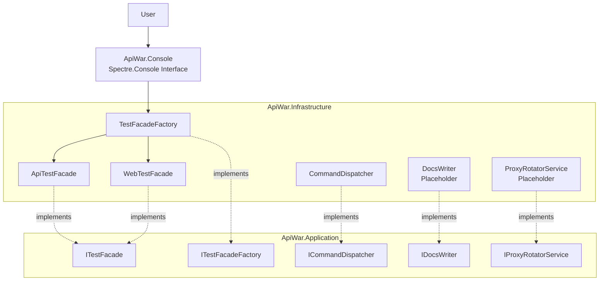
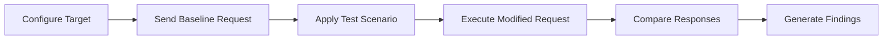

<div align="center">

# ApiWar

### A modular command-line toolkit for API and web application testing

ApiWar is being developed to evaluate authentication, access control, resilience, input validation, and security behavior through repeatable test scenarios.

<br />


</div>

---

## Overview

**ApiWar** is a .NET command-line project for testing APIs and web applications.

The project aims to turn common security and resilience checks into configurable, repeatable scenarios. Its intended scope includes authentication, authorization, rate limiting, endpoint behavior, form handling, session management, and input validation.

It is built with **.NET 10**, **C#**, and **Spectre.Console**, with separate projects for application contracts, infrastructure implementations, and the console interface.

---

## Project status

ApiWar is currently in **early development**.

The interactive console interface, test selection menus, factory, and facade structure are implemented. Test execution methods are currently placeholders.

### Currently implemented

- Styled terminal interface with Spectre.Console
- API and Web test selection
- Category menus for both test types
- Factory-based test facade creation
- Shared test execution contracts
- Separate Application, Infrastructure, and Console projects
- Initial command dispatcher
- Reporting and proxy service contracts with placeholder implementations

### Planned capabilities

- HTTP request execution
- Target and endpoint configuration
- Authentication and authorization scenarios
- Load and rate limit testing
- Response comparison and analysis
- Web form, login, input, and session checks
- Controlled injection checks
- OpenAPI document import
- Structured reports
- Sensitive value masking
- Configurable execution limits
- Automated tests

Selecting a test category currently invokes its placeholder method and returns to the main selection flow.

---

## Test categories

### API testing

The API menu contains the following categories:

| Category | Intended scope | Status |
|---|---|---|
| **Authentication** | Evaluate authentication behavior with different credentials and token conditions | Menu available; execution pending |
| **Load** | Measure response behavior under configurable request volume and concurrency | Menu available; execution pending |
| **Rate Limit** | Evaluate request throttling and rate limit responses | Menu available; execution pending |
| **Endpoint** | Check endpoint responses, methods, and expected behavior | Menu available; execution pending |

### Web testing

The Web menu contains the following categories:

| Category | Intended scope | Status |
|---|---|---|
| **Form** | Evaluate form submission and validation behavior | Menu available; execution pending |
| **Login** | Evaluate login responses and authentication workflows | Menu available; execution pending |
| **Input** | Check handling of missing, malformed, and unexpected input | Menu available; execution pending |
| **Session** | Evaluate session handling and lifecycle behavior | Menu available; execution pending |
| **SQL Injection** | Check for potential injection indicators using controlled inputs | Menu available; execution pending |

---

## Architecture

ApiWar separates terminal interaction, application contracts, and technical implementations.



### Project responsibilities

| Project | Responsibility |
|---|---|
| **ApiWar.Console** | Application entry point, terminal presentation, interactive test selection |
| **ApiWar.Application** | Contracts for test facades, factory creation, commands, reporting, and proxy services |
| **ApiWar.Infrastructure** | Concrete implementations of application contracts and test category dispatching |

### Execution flow

1. The console displays the application banner.
2. The user selects **API** or **Web**.
3. `TestFacadeFactory` creates the matching facade.
4. The facade provides its available test categories.
5. The user selects a category.
6. The console invokes `ExecuteAsync` on the selected facade.
7. The application returns to the main selection menu.

---

## Technology stack

| Category | Technologies |
|---|---|
| **Runtime** | .NET 10 |
| **Language** | C# |
| **Application type** | Interactive console application |
| **Terminal interface** | Spectre.Console 0.57.2 |
| **Architecture** | Layered project structure |
| **Design patterns** | Factory, Facade |
| **Execution contracts** | Task-based asynchronous methods |
| **Solution format** | `.slnx` |

---

## Project structure

```text
ApiWar/
├── ApiWar.Application/
│   ├── Commands/
│   │   └── ICommandDispatcher.cs
│   ├── Proxy/
│   │   └── IProxyRotatorService.cs
│   ├── Reporting/
│   │   └── IDocsWriter.cs
│   ├── Testing/
│   │   ├── Facades/
│   │   │   └── ITestFacade.cs
│   │   └── Factories/
│   │       └── ITestFacadeFactory.cs
│   └── ApiWar.Application.csproj
│
├── ApiWar.Infrastructure/
│   ├── Commands/
│   │   └── CommandDispatcher.cs
│   ├── Proxy/
│   │   └── ProxyRotatorService.cs
│   ├── Reporting/
│   │   └── DocsWriter.cs
│   ├── Testing/
│   │   ├── Facades/
│   │   │   ├── ApiTestFacade.cs
│   │   │   └── WebTestFacade.cs
│   │   └── Factories/
│   │       └── TestFacadeFactory.cs
│   └── ApiWar.Infrastructure.csproj
│
├── ApiWar.Console/
│   ├── Program.cs
│   └── ApiWar.Console.csproj
│
├── .gitignore
├── ApiWar.slnx
└── README.md
```

The solution currently contains **three projects** and **one executable console application**.

---

## Getting started

### Prerequisites

- [.NET 10 SDK](https://dotnet.microsoft.com/download/dotnet/10.0)
- Git
- An interactive terminal

Check the installed SDK:

```bash
dotnet --version
```

The project targets `net10.0`.

### Clone the repository

```bash
git clone https://github.com/emreucbudak/ApiWar.git
cd ApiWar
```

### Restore dependencies

```bash
dotnet restore ApiWar.slnx
```

### Build the solution

```bash
dotnet build ApiWar.slnx
```

### Run the application

```bash
dotnet run --project ApiWar.Console/ApiWar.Console.csproj
```

---

## Interactive usage

The application starts with an **API WAR** banner and a Turkish welcome message.

Use the arrow keys to navigate and press **Enter** to select an option.

```text
API
Web
```

Selecting **API** opens:

```text
Authentication
Load
Rate Limit
Endpoint
```

Selecting **Web** opens:

```text
Form
Login
Input
Session
SQL Injection
```

Press **Ctrl+C** to stop the application.

The current entry point uses interactive menus. Command-line scan arguments and target configuration are planned.

---

## Planned scenario workflow

The intended testing workflow compares a normal request with controlled variations.



Planned comparison signals include:

- HTTP status codes
- Response headers
- Response bodies
- Response size
- Response time
- Error details
- Rate limit information
- Differences between authentication and authorization contexts

Findings should include enough context to reproduce and review the observed behavior.

This workflow is a development goal; it is not implemented in the current test methods.

---

## Reporting

The project defines reporting through `IDocsWriter`, with a corresponding `DocsWriter` implementation.

Report generation is currently a placeholder.

Planned output formats include:

- Console
- JSON
- Markdown
- HTML
- SARIF

Planned finding details include:

- Finding title and description
- Test category
- Affected endpoint and HTTP method
- Expected and observed behavior
- Response status and timing
- Risk and confidence levels
- Masked request and response evidence
- Reproduction steps
- Suggested remediation

---

## Roadmap

- [x] Create the .NET 10 solution
- [x] Separate Application, Infrastructure, and Console projects
- [x] Build the interactive terminal interface
- [x] Add API and Web selection menus
- [x] Implement factory-based facade selection
- [x] Add test category dispatching
- [x] Define reporting and proxy service contracts
- [ ] Implement target and endpoint configuration
- [ ] Build the HTTP execution layer
- [ ] Implement API test scenarios
- [ ] Implement Web test scenarios
- [ ] Add configurable request limits and timeouts
- [ ] Add baseline response comparison
- [ ] Implement report generation
- [ ] Add sensitive value masking
- [ ] Support OpenAPI document import
- [ ] Add unit and integration tests
- [ ] Add CI/CD integration
- [ ] Prepare .NET global tool packaging and publication

---

## Development

Build the solution in Release mode:

```bash
dotnet build ApiWar.slnx --configuration Release
```

The repository does not currently contain automated test projects.

When extending test behavior, keep application contracts in `ApiWar.Application`, technical implementations in `ApiWar.Infrastructure`, and terminal interaction in `ApiWar.Console`.

---

## Contributing

Contributions, bug reports, and feature suggestions are welcome.

1. Fork the repository.
2. Create a feature branch.

```bash
git checkout -b feature/your-feature-name
```

3. Implement your changes.
4. Verify that the solution builds.
5. Add relevant tests when introducing executable test behavior.
6. Commit your changes and open a pull request.

Describe the affected test category, expected behavior, and any request traffic or data changes introduced by your contribution.

---

## Responsible use

Use ApiWar only against systems you own or have explicit permission to test.

Define the permitted targets, operations, test accounts, and traffic limits before running future test implementations.

---

<div align="center">

Built with **.NET 10**, **C#**, and **Spectre.Console**.

**ApiWar — Explore how your APIs and web applications behave under unexpected conditions.**

</div>
